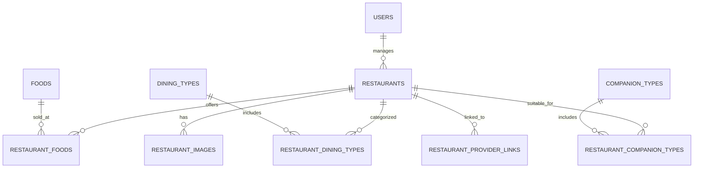

# DATABASE — Neon PostgreSQL + Prisma

> Thiết kế logic cho MVP. Dùng PostgreSQL trên Neon, Prisma ORM; thay đổi schema bằng migrations có review.

## 1. Nguyên tắc mô hình

- Quán (`restaurants`) là thực thể chính, món (`foods`) liên kết nhiều-nhiều qua `restaurant_foods`.
- Một quán có thể thuộc nhiều nhóm ăn (`dining_types`) và phù hợp nhiều kiểu người đi cùng (`companion_types`).
- Dữ liệu nội bộ và dữ liệu Places **không nhập chung vô điều kiện**; dữ liệu bên ngoài chỉ lưu khi điều khoản cho phép.
- Dùng `UUID` cho ID nội bộ, `slug` unique cho URL thân thiện.
- Tọa độ WGS84 `latitude` / `longitude`; giới hạn hợp lệ [-90,90] / [-180,180].
- Giá tiền integer VND, nullable; `price_min <= price_max` nếu cả hai tồn tại.
- Thời gian lưu UTC; trình bày theo múi giờ của người dùng.

## 2. ERD (logic)



## 3. Bảng dữ liệu

### `restaurants`

| Cột | Kiểu gợi ý | Ràng buộc / ý nghĩa |
|---|---|---|
| `id` | UUID | PK |
| `name` | VARCHAR(200) | NOT NULL |
| `slug` | VARCHAR(240) | UNIQUE, NOT NULL |
| `description` | TEXT | Nullable |
| `address` | TEXT | NOT NULL |
| `latitude` | DOUBLE PRECISION | NOT NULL, -90..90 |
| `longitude` | DOUBLE PRECISION | NOT NULL, -180..180 |
| `price_min`, `price_max` | INTEGER | Nullable, >= 0 |
| `status` | ENUM | `draft`, `published`, `hidden` |
| `opening_hours` | JSONB | Nullable, chuẩn hóa sau |
| `created_by_id` | UUID | FK users, nullable khi seed |
| `created_at`, `updated_at` | TIMESTAMPTZ | Audit |

### `foods`
`id` UUID PK; `name` VARCHAR; `slug` UNIQUE; `description` nullable; `category` hoặc FK danh mục con; `created_at`, `updated_at`.

### `restaurant_foods`
`restaurant_id` FK; `food_id` FK; `price_vnd` nullable; `is_available` nullable; PRIMARY KEY (`restaurant_id`, `food_id`). Giá là giá **tại quán**, không phải giá toàn cục của món.

### `dining_types` và `restaurant_dining_types`
- Seed: `snack` / Ăn vặt, `meal` / Ăn bình thường, `drinking` / Đi nhậu.
- Bảng nối có khóa chính kép (`restaurant_id`, `dining_type_id`).

### `companion_types` và `restaurant_companion_types`
- Seed: `couple` / Người yêu, `friends` / Nhóm bạn, `solo` / Một mình.
- Bảng nối gồm `restaurant_id`, `companion_type_id`, `suitability_score` (0–100, tùy chọn). Dùng để **xếp hạng**, không loại cứng.

### `restaurant_images`
`id`, `restaurant_id`, `cloudinary_public_id`, `secure_url`, `width`, `height`, `alt_text`, `sort_order`, `rights_source`, `uploaded_by`, `created_at`. Ảnh thực tế nằm tại **Cloudinary**; Neon chỉ lưu metadata và đường dẫn. Không lưu file nhị phân trong Vercel Functions.

### `restaurant_provider_links`
`id`, `restaurant_id`, `provider` (ví dụ `google`), `provider_place_id`, `verified_at`, `created_at`. UNIQUE (`provider`, `provider_place_id`). Chỉ lưu định danh nhà cung cấp khi điều khoản cho phép; kiểm tra điều khoản cụ thể trước khi triển khai.

### `users`
`id`, `email` UNIQUE, `password_hash` hoặc provider auth ID, `role` (`admin`), `created_at`, `updated_at`. Không lưu mật khẩu plaintext; mật khẩu hash bằng thuật toán phù hợp.

## 4. Chỉ mục và truy vấn gần đây

- `restaurants(status)`, `restaurants(slug)`, các khóa ngoại bảng nối.
- Với MVP nhỏ: lọc sơ bộ theo bounding box lat/lng, sau đó tính **Haversine** bằng SQL hoặc JS phía backend; kiểm tra `distanceKm <= radiusKm`.
- Với dữ liệu lớn: đánh giá **PostGIS** và chỉ mục không gian nếu Neon project/extension hỗ trợ. Không giả định PostGIS đã được bật.
- Bán kính mặc định 10 km, giới hạn backend tối đa 10 km. Tọa độ không hợp lệ phải bị từ chối.

Ví dụ công thức Haversine (km):

```js
export function distanceKm(lat1, lon1, lat2, lon2) {
  const toRad = (deg) => (deg * Math.PI) / 180;
  const dLat = toRad(lat2 - lat1);
  const dLon = toRad(lon2 - lon1);
  const a = Math.sin(dLat / 2) ** 2 +
    Math.cos(toRad(lat1)) * Math.cos(toRad(lat2)) *
    Math.sin(dLon / 2) ** 2;
  return 6371.0088 * 2 * Math.asin(Math.min(1, Math.sqrt(a)));
}
```

## 5. Seed tối thiểu

- 3 `dining_types`, 3 `companion_types`.
- 30–50 quán **có tọa độ xác minh** trong một khu vực thử nghiệm.
- Mỗi quán gắn >= 1 dining type, các companion score nếu có cơ sở.
- Danh mục món cơ bản và liên kết menu theo thông tin có thật.
- Dữ liệu demo phải được đánh dấu, không xuất hiện như quán thật trên production.

## 6. Neon, Prisma và an toàn

- Dùng Neon **pooled connection** (`DATABASE_URL`, hostname có `-pooler`) cho runtime serverless; **direct connection** (`DIRECT_URL`) cho Prisma migrations, backup và tác vụ cần session state. Cấu hình Prisma phiên bản đang dùng qua `prisma.config.js` nếu phù hợp.
- `DATABASE_URL` chỉ ở backend env, không có tiền tố `VITE_`.
- Migration chạy qua CI hoặc lệnh quản trị có kiểm soát, **không chạy migration tự động trên mỗi request Function**.
- Tạo Prisma client singleton cho môi trường có tái sử dụng instance; tránh tạo connection mới cho từng truy vấn.
- Backup, restore test, phân quyền DB tối thiểu, giới hạn dữ liệu cá nhân và retention logs.
- Khi thay đổi Prisma major version, kiểm tra hướng dẫn generator/adapter hiện hành trước khi áp dụng code mẫu.

## 7. Tương lai

Có thể thêm `favorites`, `suggestion_logs`, `opening_hours_normalized`, `restaurant_reviews` (chỉ dữ liệu có quyền sử dụng), `moderation_logs`. Không triển khai sớm nếu chưa cần.


## 8. Quy ước ảnh Cloudinary và nguồn dữ liệu

- UNIQUE(`cloudinary_public_id`) trong `restaurant_images`; ưu tiên giữ `public_id` để phục vụ xóa/đổi ảnh an toàn.
- `secure_url` thuộc ảnh nội bộ, không lấy URL ảnh provider để upload lại.
- Có thể thêm `food_images` với schema tương tự, FK `food_id`.
- `restaurant_provider_links` chỉ lưu provider + place ID đã được xác minh/được phép, không lưu cache vĩnh viễn tên/địa chỉ/rating/ảnh của Google.
- Tạo indexes: `restaurant_images(restaurant_id, sort_order)`, `restaurant_provider_links(provider, provider_place_id)`, `restaurant_dining_types(restaurant_id, dining_type_id)`.
- Khi admin ẩn quán (`status=hidden`), không xóa ngay ảnh; cung cấp thao tác dọn ảnh riêng có xác nhận và audit.

## 9. Bảo mật, quyền dữ liệu và migration

- Không dùng Prisma migration ngay trong Vercel Function. Chạy `prisma migrate deploy` từ CI/job admin với direct URL và kiểm soát quyền.
- Thực hiện migration trước khi deploy phiên bản backend cần cột mới, theo chiến lược thay đổi tương thích ngược.
- `users.password_hash` chỉ chứa hash (ví dụ Argon2id) và xác thực bằng cookie HttpOnly/Secure, bảo vệ CSRF khi cần.
- Địa chỉ GPS của khách chỉ cần xử lý trong request; không lưu vào logs chi tiết khi không cần.
- Seed phân loại bằng mã cố định (`couple/friends/solo`, `snack/meal/drinking`) để đồng bộ Frontend/API/DB.

**Tham khảo:** https://neon.com/docs/connect/connection-pooling · https://www.prisma.io/docs/orm/v7/reference/prisma-config-reference
