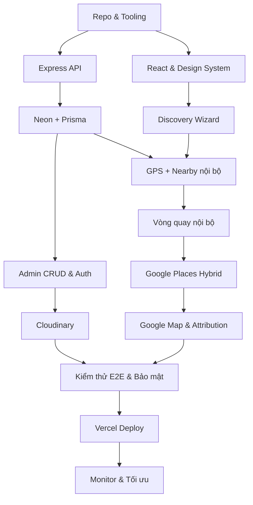

# ROADMAP DETAILED — Lộ trình phát triển từng bước (Full-Stack Hybrid)

> **Dự án:** Hôm Nay Ăn Gì? · **Phiên bản:** 2.0 (14/11/2026)  
> **Stack:** React + Vite + **JavaScript** + Tailwind CSS · Express + **JavaScript** · Prisma + Neon PostgreSQL · Cloudinary · Vercel · Google Places API (New) khi bật Hybrid.  
> **Quy tắc học/làm:** Chỉ làm **01 bước nhỏ/lần**. Hiểu → thực hành → chạy kiểm tra → commit → mới sang bước kế tiếp. Không dựng tất cả file/thư mục trước khi dùng.

## A. Kết quả cuối cùng cần đạt

Website có ba lựa chọn **người yêu / nhóm bạn / một mình**, ba nhu cầu **ăn vặt / ăn bình thường / đi nhậu**. Người dùng chọn GPS hoặc địa điểm thủ công, xem quán trong tối đa **10 km** (đường chim bay), lọc theo nhu cầu và xoay **vòng quay chọn món hoặc quán**. Admin quản lý quán, món và ảnh. Dữ liệu từ **Neon** (quán nội bộ) cộng **Google Places** (external, tùy bật), có ghi nguồn và không lưu trữ dữ liệu vi phạm điều khoản. Frontend/Backend chạy trên **hai Vercel Projects**, ảnh do admin quản lý trên Cloudinary.

**Phạm vi MVP:** không cần tài khoản khách, đặt bàn, thanh toán, đánh giá người dùng, AI recommendation, đồng bộ toàn quốc hoặc chỉ đường theo đường phố. Không giả dữ liệu quán thật, rating, trạng thái mở cửa.

## B. Cách dùng tài liệu này khi làm với AI

1. Đọc `docs/PROJECT_OVERVIEW.md` rồi `docs/ROADMAP_DETAILED.md`.
2. Chỉ thực hiện bước chưa tích đầu tiên (`[ ]`). AI phải giải thích **mục đích, nơi chạy lệnh, file cần sửa, vì sao làm, cách kiểm tra và commit**.
3. Nếu có lỗi, dừng tại bước đang làm, kiểm tra output rồi sửa; không nhảy tới phần khác.
4. Sau khi hoàn thành, đổi `[ ]` thành `[x]`, ghi commit hash vào nhật ký (mục N).
5. Ứng dụng viết **JS/JSX**. Nếu công cụ tự tạo `.ts` hoặc `.tsx`, kiểm tra tùy chọn `.js/.mjs` thay thế; không tự chuyển code ứng dụng sang TS.
6. Mỗi phase có mốc **Definition of Done** (DoD). Nếu không đạt thì chưa sang phase tiếp.
7. Tránh đưa password, Neon URL, Cloudinary API secret, Google server key lên GitHub hoặc vào log/chat công khai.

## C. Sơ đồ thứ tự phụ thuộc



## PHASE 0 — Chuẩn bị công cụ, tài khoản, quyết định

**Mục tiêu:** máy tính phát triển sẵn sàng, hiểu MVP và giới hạn dịch vụ.

- [x] **0.1 — Kiểm tra phiên bản.** Trong PowerShell/VS Code Terminal chạy: `node -v`, `npm -v`, `git --version`. Chọn Node LTS đáp ứng yêu cầu phiên bản Vite/Prisma hiện hành. **Đạt:** ba lệnh trả version, không có lỗi không nhận lệnh.
- [x] **0.2 — Kiểm tra VS Code và terminal.** Mở được thư mục D:\ hoặc nơi lưu repo, tạo và xóa file thử. **Đạt:** VS Code terminal dùng được.
- [x] **0.3 — Kiểm tra tài khoản.** GitHub, Vercel, Neon, Cloudinary; Google Cloud *chưa cần bật billing* ở phase này. **Đạt:** đăng nhập dashboard và kiểm tra hạn mức miễn phí theo ngày dùng.
- [x] **0.4 — Đọc yêu cầu và quyết định phạm vi.** Xác nhận 3 companion codes, 3 dining codes, radius `1..10`, món/quán, admin CRUD, Hybrid có thể tắt. **Đạt:** không tự thêm tính năng ngoài MVP.
- [x] **0.5 — Chọn khu vực thử nghiệm.** Chỉ sử dụng quán có địa chỉ/tọa độ xác minh; dữ liệu demo phải gắn nhãn. **Đạt:** có danh sách nguồn nhập dữ liệu đáng tin cậy.

**DoD:** công cụ hoạt động, tài khoản sẵn sàng, không có bí mật nào trong repo.

## PHASE 1 — Monorepo và Git Foundation

**Mục tiêu:** một repo `hom-nay-an-gi` chứa hai ứng dụng và bộ docs.

- [x] **1.1 — Tạo thư mục và Git.** PowerShell: `mkdir hom-nay-an-gi`, `cd hom-nay-an-gi`, `git init`. **Đạt:** `git status` trả nhánh hiện tại.
- [x] **1.2 — Tạo `.gitignore`.** Loại trừ `node_modules/`, `dist/`, `.env`, `.env.*` nhạy cảm (cho phép `.env.example`), `.vercel/`, logs, coverage. **Đạt:** `.env` không nằm trong `git status`.
- [x] **1.3 — Thêm README và `docs/`.** Chép tài liệu trong gói này vào repo. README có mô tả, stack, cách chạy (sẽ cập nhật). **Đạt:** VS Code hiển thị docs, link Markdown hoạt động.
- [x] **1.4 — Commit đầu tiên.** `git add .`, `git commit -m "chore: initialize repository and project docs"`. **Đạt:** `git log -1 --oneline` thấy commit.
- [x] **1.5 — Tạo GitHub repository.** Repo không chứa secrets; thêm `remote origin` và push nhánh chính theo hướng dẫn GitHub. **Đạt:** mở repo trên GitHub thấy README và docs.

**DoD:** repo tồn tại, docs được version-control, branch và remote rõ ràng.

## PHASE 2 — Frontend React + Vite + Tailwind

**Mục tiêu:** web chạy trên local, responsive cơ bản, chưa cần backend.

- [x] **2.1 — Khởi tạo frontend JS.** Ở thư mục gốc: `npm create vite@latest frontend -- --template react` (chạy khi `frontend/` chưa tồn tại hoặc thư mục trống); chọn **JavaScript**, không TypeScript. **Đạt:** `frontend/package.json`, `src/main.jsx`.
- [x] **2.2 — Chạy dev.** `cd frontend`, `npm install`, `npm run dev`. **Đạt:** truy cập Vite local, không lỗi console.
- [x] **2.3 — Dọn mã mẫu đúng chỗ.** Thay logo/counter của Vite bằng một trang `HomePage` tối thiểu. Không xóa cấu hình cần thiết. **Đạt:** hiển thị tiêu đề “Hôm Nay Ăn Gì?”.
- [x] **2.4 — Cài Tailwind theo đúng phiên bản hiện hành.** Ưu tiên tài liệu chính thức cho React Vite, vì quy trình cài có thể thay đổi giữa các major version. **Đạt:** dùng được utility class trong `.jsx`.
- [x] **2.5 — Cài Router, khung trang.** Dùng React Router với `/`, `/explore`, `/wheel`, `/restaurants/:id`, `/admin/login` (placeholder ban đầu). **Đạt:** click route và refresh local không lỗi.
- [x] **2.6 — Tạo shared layout.** Header, Footer, `Container`, `Button`, `Input`, `PageTitle` theo nhu cầu. **Đạt:** component import dùng lại được, không duplicate CSS.
- [x] **2.7 — Commit frontend foundation.** `chore(frontend): scaffold React Vite JavaScript app`; `feat(ui): add Tailwind and shared layout`. **Đạt:** 2 commit tách chức năng.

**DoD:** frontend chạy ở local, mobile không tràn ngang, JS/JSX, không secret.

## PHASE 3 — Design System và UI/UX Foundation

**Mục tiêu:** giao diện “Foodie Adventure” nhất quán, đáp ứng accessibility cơ bản.

- [x] **3.1 — Tạo tokens.** Màu `#FF6B4A`, `#FFB84D`, `#FFF9F2`, text `#252525`, border `#EAE5DF`; font Be Vietnam Pro; spacing và radius. **Đạt:** màu dùng qua tokens, không hard-code khắp nơi.
- [x] **3.2 — Component states.** Button với `loading/disabled`, Input có label/error, Card có hover/focus. **Đạt:** keyboard focus nhìn rõ và disabled thật sự không bấm được.
- [x] **3.3 — Responsive shells.** Container mobile padding 16px, desktop max width, header/mobile nav. **Đạt:** 360px, tablet, desktop không overflow.
- [x] **3.4 — Trang chủ.** Hero copy, 3 lựa chọn cùng ai, 3 nhóm ăn; CTA khám phá và vòng quay. **Đạt:** hiểu sản phẩm sau khi nhìn màn hình đầu.
- [x] **3.5 — Trạng thái tổng quát.** Loading Skeleton, EmptyState, ErrorState, toast/inline feedback. **Đạt:** có text rõ ràng, không chỉ spinner.
- [x] **3.6 — Commit.** `feat(ui): establish Foodie Adventure design system`. **Đạt:** màn hình mobile và desktop được kiểm tra.

**DoD:** không phụ thuộc ảnh giả đóng vai quán thật; tương phản CTA hợp lý; có focus visible và reduced-motion guideline.

## PHASE 4 — Discovery Wizard 3 bước

**Mục tiêu:** lựa chọn phù hợp trước khi truy vấn quán.

- [x] **4.1 — CompanionPicker.** `couple/friends/solo`, mỗi ô có icon, nhãn, trạng thái chọn. **Đạt:** chọn một mục duy nhất, tương tác keyboard.
- [x] **4.2 — DiningTypePicker.** `snack/meal/drinking`; không đánh đồng `drinking` với hành vi tiêu thụ rượu bắt buộc. **Đạt:** một nhóm ăn hiện hành, nhiều nhóm có thể gắn một quán trong DB.
- [x] **4.3 — LocationPicker dạng mock.** Radio GPS hoặc vị trí thủ công, ô nhập tìm địa điểm chưa nối provider, control bán kính từ 1 đến 10. **Đạt:** không đi bước kết quả nếu chưa có tọa độ chọn thật hoặc mock hợp lệ.
- [x] **4.4 — Store lựa chọn.** Zustand hoặc React Context nếu state nhỏ; chỉ ghi tùy chọn không nhạy cảm vào localStorage. **Đạt:** về trang trước còn lựa chọn.
- [x] **4.5 — Điều hướng.** Sau ba bước, đi `/explore`; hiển thị tóm tắt filter và nút sửa lựa chọn. **Đạt:** không làm mất selection.
- [x] **4.6 — Unit test wizard.** Thử chọn/đổi companion, loại ăn, bán kính ngoài range, GPS denied. **Đạt:** tất cả cases pass.
- [x] **4.7 — Commit.** `feat(discovery): implement three-step preference wizard`. **Đạt:** thử end-to-end UI không cần API.

**DoD:** người dùng đi được luồng chọn 3 bước không đăng nhập.

## PHASE 5 — Express API Foundation

**Mục tiêu:** backend JS có cấu trúc module, kiểm tra health, lỗi có format chuẩn.

- [x] **5.1 — Khởi tạo backend.** Trong `backend/`: `npm init -y`, chọn ESM qua `"type": "module"` trong package.json. **Đạt:** chạy được script Node.js.
- [x] **5.2 — Cài cơ bản.** `npm install express cors helmet zod dotenv` và công cụ dev/test phù hợp. **Đạt:** không có lỗi import.
- [x] **5.3 — Tách app/server.** `src/app.js` export Express app; `backend/dev.js` gọi `listen()` chỉ local. Vercel hiện có hỗ trợ tự nhận diện `src/app.js` có default export, nên chưa cần `api/index.js`. **Đạt:** 2 entrypoint dùng chung app.
- [x] **5.4 — Health + response.** `GET /api/v1/health` trả `{ data: { status: 'ok' } }`, error handler trả JSON thống nhất. **Đạt:** kiểm thử qua curl hoặc trình duyệt.
- [x] **5.5 — Middleware.** `helmet`, CORS theo origin, parse JSON size limit, Zod query/body validation, 404. **Đạt:** request input sai trả 400, không 500.
- [x] **5.6 — Automated test.** Unit/integration test health, 404, validation. **Đạt:** `npm test` pass (script phải được cấu hình).
- [x] **5.7 — Commit.** `feat(api): initialize Express API and validation`. **Đạt:** frontend có thể gọi health qua env dev.

**DoD:** API local hoạt động, không cần database để chạy health.

## PHASE 6 — Neon PostgreSQL + Prisma + Seed

**Mục tiêu:** dữ liệu quán nội bộ có mô hình chuẩn và migration tái lập được.

- [x] **6.1 — Tạo Neon project.** Chọn region gần người dùng phù hợp; lấy **pooled** và **direct** connection strings. **Đạt:** lưu local `.env` (không commit), không rò rỉ URL.
- [x] **6.2 — Cài Prisma.** Chốt Prisma major hiện hành, dùng config JS (`prisma.config.js/.mjs`) nếu hỗ trợ; `schema.prisma`, Prisma Client và driver adapter theo tài liệu Neon/Prisma. **Đạt:** `prisma validate` (hoặc lệnh tương đương) pass.
- [x] **6.3 — Tạo enums/code phân loại.** `couple/friends/solo`, `snack/meal/drinking`; không dùng label tiếng Việt làm ID. **Đạt:** mã không sai chính tả qua frontend/backend.
- [x] **6.4 — Tạo tables core.** `restaurants`, `foods`, `restaurant_foods`, `dining_types`, `restaurant_dining_types`, `companion_types`, `restaurant_companion_types`. **Đạt:** các FK/unique/index tồn tại.
- [x] **6.5 — Thêm tables hỗ trợ.** `restaurant_images`, `food_images` (Cloudinary metadata), `users`, `restaurant_provider_links` (chỉ provider ID). **Đạt:** không dùng trường chứa ảnh nhị phân hoặc cache Google không được phép.
- [x] **6.6 — Migration trên local/development.** `prisma migrate dev --name init` với direct URL theo cấu hình version; commit migration. **Đạt:** migrate từ database sạch thành công.
- [x] **6.7 — Seed.** Chèn 3 companion, 3 dining, danh mục món; nhập một vài **quán được xác minh** hoặc demo có nhãn rõ. **Đạt:** query DB thấy liên kết đúng.
- [x] **6.8 — Test DB.** Thử unique slug, giới hạn tọa độ, giá min/max, category nhiều-nhiều, rollback khi vi phạm. **Đạt:** ràng buộc hoạt động.
- [x] **6.9 — Commit.** `feat(db): add Neon Prisma schema and seed`. **Đạt:** mỗi schema migration có trong Git.

**DoD:** không lưu ảnh trong Neon; database có seed để phát triển nhưng không công bố quán demo như quán thật.

## PHASE 7 — API quán nội bộ và tìm kiếm cơ bản

**Mục tiêu:** frontend đọc danh sách/chi tiết quán do admin tự quản lý.

- [x] **7.1 — Repository layer.** `restaurant.repository.js` chứa truy vấn Prisma; không đặt query SQL rải trong controller. **Đạt:** test repository mock được.
- [x] **7.2 — API danh sách.** `GET /api/v1/restaurants` với `page/limit`, lọc status active, dữ liệu null giữ nguyên. **Đạt:** `limit` có max chống trả hàng nghìn dòng.
- [x] **7.3 — API chi tiết.** `GET /api/v1/restaurants/:id` có món, ảnh, groups. **Đạt:** không tìm thấy trả 404.
- [x] **7.4 — Danh sách FE.** `RestaurantCard`, `RestaurantList`, skeleton/empty/error; TanStack Query nếu cần cache. **Đạt:** hiển thị từ API thật.
- [x] **7.5 — Trang chi tiết.** Ảnh, địa chỉ, nhóm ăn, khoảng giá nullable, chỉ đường dựa trên tọa độ nội bộ. **Đạt:** thiếu rating không hiện 0 sao giả.
- [x] **7.6 — Commit.** `feat(restaurants): add list and detail endpoints`. **Đạt:** từ homepage đi được trang chi tiết.

**DoD:** dữ liệu nội bộ chạy xuyên frontend -> backend -> Neon.

## PHASE 8 — Admin Login + CRUD quán/món

**Mục tiêu:** bạn tự đăng quán mới mà không cần sửa code/deploy lại.

- [x] **8.1 — Chốt auth.** Thiết kế login admin server-side, hash mật khẩu mạnh (ưu tiên Argon2id hoặc cơ chế tương đương được hỗ trợ), cookie HttpOnly Secure; session tương thích serverless. **Đạt:** không dùng memory session trong Function, không lưu mật khẩu plaintext.
- [x] **8.2 — Tạo admin đầu tiên.** Seed/CLI quản trị an toàn, không hardcode tài khoản thật trong Git. **Đạt:** mật khẩu được hash, không in ra log.
- [x] **8.3 — `POST /auth/login`, `GET /auth/me`, `POST /auth/logout`.** Thêm rate limit; origin/CSRF protection nếu dùng cookies. **Đạt:** sai mật khẩu trả lỗi chung, không tiết lộ user có tồn tại.
- [x] **8.4 — Middleware admin.** Chặn API thay đổi dữ liệu với role, không chỉ ẩn button frontend. **Đạt:** request không session trả 401, user thiếu role 403.
- [x] **8.5 — Form quán.** Name, slug, địa chỉ, tọa độ, 3 nhóm ăn (nhiều chọn), mức phù hợp companion, status draft/active/hidden. **Đạt:** lỗi nhập hiển thị cạnh field.
- [x] **8.6 — CRUD API.** POST/PATCH/DELETE(soft) restaurants; trường hợp slug trùng hoặc tọa độ sai trả lỗi đúng. **Đạt:** thêm quán mới thấy trong `/explore` khi active.
- [x] **8.7 — CRUD món/menu.** Foods và restaurant_foods để quán bán nhiều món; giá VND từ menu thực tế. **Đạt:** có thể gắn một món vào nhiều quán.
- [x] **8.8 — Audit và test quyền.** Ghi thao tác admin cơ bản, test unauthorized/forbidden. **Đạt:** không bypass bằng API thủ công.
- [x] **8.9 — Commit.** `feat(admin): implement protected restaurant and menu CRUD`. **Đạt:** quản trị hoạt động hoàn toàn từ UI.

**DoD:** thêm/sửa/ẩn quán được mà không push/deploy code lại.

## PHASE 9 — Cloudinary ảnh quán/món

**Mục tiêu:** upload, hiển thị, đổi và xóa ảnh có xác thực.

- [x] **9.1 — Tạo Cloudinary account.** Lấy cloud name, API key, API secret; ghi tại backend `.env`. **Đạt:** `CLOUDINARY_API_SECRET` không có ở FE/Git.
- [x] **9.2 — Upload signature.** Endpoint chỉ admin, server ký giới hạn folder, resource image, timestamp. **Đạt:** user không đăng nhập không lấy được chữ ký.
- [x] **9.3 — Frontend upload ảnh.** Chọn ảnh, preview, kiểm size/type, upload trực tiếp Cloudinary với signed params; hiển thị progress/lỗi. **Đạt:** file không đi qua Vercel Function làm bộ đệm.
- [x] **9.4 — Ghi metadata.** Express xác minh asset/public_id thuộc namespace và gắn `restaurant_images` hoặc `food_images`. **Đạt:** Neon lưu URL/public ID, không lưu file.
- [x] **9.5 — Hiển thị ảnh tối ưu.** `alt`, 4:3, lazy load, ảnh phù hợp kích thước màn hình. **Đạt:** trang `/explore` có ảnh đúng quán.
- [x] **9.6 — Xóa ảnh và xử lý lỗi.** Xác minh quyền, xoá Cloudinary và cập nhật DB an toàn; xử lý orphan assets. **Đạt:** không xóa asset của quán khác.
- [x] **9.7 — Commit.** `feat(media): add secure Cloudinary image uploads`. **Đạt:** ít nhất một quán có ảnh thật qua admin.

**DoD:** Cloudinary hoạt động; không upload ảnh Google Places về Cloudinary.

## PHASE 10 — GPS, chọn địa điểm và 10 km nội bộ

**Mục tiêu:** tìm chính xác quán nội bộ quanh vị trí được chọn.

- [x] **10.1 — GPS permission.** Dùng `navigator.geolocation` khi người dùng chủ động bấm và trang chạy HTTPS; thông báo mục đích dùng vị trí. **Đạt:** GPS denied/timed out có đường nhập địa điểm.
- [x] **10.2 — Chọn vị trí thủ công.** Ban đầu cho kéo/chọn marker hoặc nhập tọa độ hợp lệ; sau đó mới tích hợp geocoder có giấy phép/chi phí phù hợp. **Đạt:** không buộc GPS để dùng được app.
- [x] **10.3 — Validate 10 km.** `lat [-90,90]`, `lng [-180,180]`, `radiusKm [1,10]`, `companion`, `diningType`, sort, pagination. **Đạt:** radius 20 trả 400, không bị tự nâng phạm vi.
- [x] **10.4 — Tính khoảng cách.** MVP dùng bounding box + Haversine chuẩn; sau đó đánh giá PostGIS/GiST nếu số quán lớn. **Đạt:** bên ngoài bán kính bị loại cả ở API, không chỉ FE.
- [x] **10.5 — API nearby nội bộ.** `GET /api/v1/restaurants/nearby`; đồng bộ `filters` với wizard. **Đạt:** tối đa 10 km địa lý từ điểm chọn.
- [x] **10.6 — Filter/rank.** `diningType` lọc nghiêm; `companion` là tín hiệu ưu tiên, không loại cứng. **Đạt:** cùng quán có thể thuộc 2 nhóm ăn.
- [x] **10.7 — Giao diện Explore.** Filter chips, sắp xếp, khoảng cách km, thẻ quán; ghi nguồn `Được quản lý bởi website`. **Đạt:** không hiển thị trạng thái mở cửa giả.
- [x] **10.8 — Test biên.** 0 km, đúng 10 km, >10 km, tọa độ ngoài range, 0 ứng viên, GPS denied. **Đạt:** test passes.
- [x] **10.9 — Commit.** `feat(location): find internal restaurants within 10km`. **Đạt:** website nội bộ dùng được không cần Google Places.

**DoD:** bán kính là đường chim bay, không tuyên bố khoảng cách lái xe.

## PHASE 11 — Vòng quay món ăn/quán ăn (dữ liệu nội bộ)

**Mục tiêu:** người dùng quyết định nhanh, kết quả không vượt bộ lọc.

- [ ] **11.1 — Xây UI vòng quay.** Tab `Quay món` / `Quay quán`, nút Quay, Quay lại, kết quả. **Đạt:** không đăng nhập vẫn dùng được.
- [ ] **11.2 — Tập ứng viên.** Restaurant candidates lấy từ nearby đã lọc; food candidates chỉ gồm món có ít nhất một quán phù hợp trong bán kính. **Đạt:** không quay món không có nơi bán.
- [ ] **11.3 — API spin.** `POST /api/v1/wheel/spin` với filters và mode; backend xác minh eligibility. **Đạt:** không tin mảng ID tùy ý do client gửi.
- [ ] **11.4 — Đồng bộ màn hình và kết quả.** Animation chỉ là presentation; dừng đúng phần tử đã được chọn; tôn trọng reduced motion. **Đạt:** kết quả hiển thị trùng với ô thắng cuộc.
- [ ] **11.5 — Reroll/avoid repeats.** Có thể gửi danh sách ID vừa thắng để tránh lặp nếu còn ứng viên; không bảo đảm tránh lặp nếu chỉ có một ứng viên. **Đạt:** edge case không deadlock.
- [ ] **11.6 — Empty/changed candidates.** Không có quán -> hướng dẫn thay filter; kết quả hết hạn -> thông báo refresh và quay lại. **Đạt:** không quay vào item không tồn tại.
- [ ] **11.7 — Commit.** `feat(wheel): add food and restaurant decision wheel`. **Đạt:** thử cả hai mode trên local.

**DoD:** vòng quay nội bộ hoạt động trước khi bật Google.

## PHASE 12 — Places Provider Adapter + Hybrid

**Mục tiêu:** hợp nhất nguồn admin và nguồn ngoài mà vẫn giữ đúng giấy phép/chi phí.

- [ ] **12.1 — Checklist trước tích hợp.** Đọc Terms/Policies mới nhất của provider; xác nhận mục đích website, map renderer, attribution, caching, billing. **Đạt:** quyết định bật Google có căn cứ.
- [ ] **12.2 — Google Cloud setup.** Tạo project, bật Places API (New), billing, tạo server API key có restrictions, đặt quota/alerts. **Đạt:** key chỉ trong backend env và quota được kiểm soát.
- [ ] **12.3 — Feature flag.** `PLACES_ENABLED=false` mặc định; bật true ở môi trường thử nghiệm khi sẵn sàng. **Đạt:** tắt provider vẫn hiển thị quán Neon.
- [ ] **12.4 — Provider interface.** `searchNearby({lat,lng,radiusKm,diningType})`, `getPlaceDetails(id)` trong `backend/src/integrations/places/`; mock adapter cho tests. **Đạt:** service không import trực tiếp Google SDK ở business layer.
- [ ] **12.5 — Google Nearby Search (New).** Backend `POST /v1/places:searchNearby` với FieldMask tối thiểu, `maxResultCount <=20`, radius m; timeout và lỗi 429. **Đạt:** response được normalize, không rò key.
- [ ] **12.6 — Mapping type.** Ánh xạ loại quán sang `snack/meal/drinking` có `confidence`; `unknown` nếu không đủ dữ liệu. **Đạt:** không khẳng định phân loại 100% chính xác.
- [ ] **12.7 — Tránh trùng.** `provider_place_id` đã xác minh -> liên kết quán internal; tên/địa chỉ gần -> gợi ý review, không tự gộp thiếu chứng cứ. **Đạt:** không nhập hai chi nhánh làm một.
- [ ] **12.8 — Hợp nhất + fallback.** Internal + external hiện hành, normalize, dedup, filter/rank; lỗi provider -> `meta.partialResults=true`. **Đạt:** dữ liệu internal vẫn hoạt động khi Google lỗi.
- [ ] **12.9 — Kiểm soát dữ liệu.** Neon chỉ lưu field từ admin/được phép và place ID ngoại lệ; không lấy Google photos/reviews, rating hay tọa độ để lưu vĩnh viễn trái điều khoản. **Đạt:** review schema/log/cache.
- [ ] **12.10 — Mock integration tests.** Google success/empty/429/timeout/500, trùng provider ID, 10 km, attribution. **Đạt:** test không tốn API bill khi chạy CI.
- [ ] **12.11 — Commit.** `feat(places): integrate compliant hybrid provider`. **Đạt:** feature flag true/false đều được test.

**DoD:** Hybrid hoạt động và có giới hạn chi phí; nếu không bật Google thì MVP vẫn đạt chức năng nội bộ.

## PHASE 13 — Bản đồ Hybrid và giao diện kết quả

**Mục tiêu:** hiển thị dữ liệu đúng bản quyền nhà cung cấp.

- [ ] **13.1 — Quyết định map renderer theo nguồn.** Danh sách nội bộ có thể dùng Leaflet/nguồn map phù hợp; **có Google Places points trên bản đồ thì phải dùng Google Map** và attribution đúng. **Đạt:** không trộn Google Places markers vào Leaflet.
- [ ] **13.2 — Lập map view.** Marker vị trí trung tâm, bán kính 10 km, các marker theo nguồn và bộ lọc; click marker mở card. **Đạt:** chuyển map/list không đổi tập ứng viên.
- [ ] **13.3 — Attribution/links.** Với Google, hiển thị logo/attribution, photo/review credits theo chính sách; có privacy/terms công khai. **Đạt:** kiểm tra bằng checklist provider.
- [ ] **13.4 — Mobile interaction.** Bottom sheet/tab list-map, nút về danh sách, map keyboard alternate. **Đạt:** điều hướng bằng danh sách không cần dùng map.
- [ ] **13.5 — Chọn quán/chỉ đường.** Link mở Google Maps hoặc dịch vụ chỉ đường bằng URL hợp lệ; không tuyên bố km đi đường từ Haversine. **Đạt:** link đúng tọa độ và không có redirect open relay.
- [ ] **13.6 — Commit.** `feat(map): add compliant map and list views`. **Đạt:** map không vi phạm chính sách Google Places khi bật Hybrid.

**DoD:** Google Places content không được vẽ lên non-Google map.

## PHASE 14 — Bảo mật, thử nghiệm, tối ưu

**Mục tiêu:** sẵn sàng công khai một MVP.

- [ ] **14.1 — Unit tests.** Validate query, Haversine, mapping, wheel candidate eligibility, rank, dedup. **Đạt:** CI test pass.
- [ ] **14.2 — Integration tests.** Auth admin, CRUD, Cloudinary signature, provider mock lỗi, Neon database. **Đạt:** lỗi 401/403/400/429 xử lý có chủ đích.
- [ ] **14.3 — E2E chính.** Chọn người đi cùng -> loại ăn -> vị trí -> Explore -> Wheel -> xem chi tiết; admin login -> tạo quán -> ảnh -> ẩn. **Đạt:** luồng chạy từ màn hình.
- [ ] **14.4 — Kiểm tra bảo mật.** Secret leaks, session cookie/CSRF, CORS, input validation, rate limit, uploads, logging GPS. **Đạt:** user thường không thể gọi admin mutation.
- [ ] **14.5 — UX/a11y.** Responsive 360px, tablet, desktop; focus keyboard, color contrast, aria-live wheel, reduced-motion, empty/error. **Đạt:** không có lỗi UX chặn luồng chính.
- [ ] **14.6 — Performance.** Ảnh Cloudinary responsive/lazy, API pagination, debounce tìm kiếm, timeout provider, không request Places mỗi lần render. **Đạt:** tránh calls không chủ đích.
- [ ] **14.7 — Privacy/attribution.** Có Terms/Privacy công khai theo policy, không giữ GPS của khách nếu không cần. **Đạt:** đã review trước khi bật production.
- [ ] **14.8 — Commit.** `test: cover discovery admin wheel and hybrid flows`. **Đạt:** CI chạy và cho kết quả rõ.

**DoD:** không có lỗi bảo mật nghiêm trọng đã biết, có thể tắt Places provider khi cần.

## PHASE 15 — Deploy hai Vercel Projects & Neon/Cloudinary Production

**Mục tiêu:** website có URL công khai mà **không thuê VPS**.

- [ ] **15.1 — Chuẩn bị GitHub.** Push branch ổn định, các `.env` không bị commit; README có commands. **Đạt:** secrets không ở repo.
- [ ] **15.2 — Tạo Vercel Backend Project.** Import cùng repo, Root Directory `backend/`, deploy Express Function, gọi `/api/v1/health`. **Đạt:** response JSON production, không 404/500.
- [ ] **15.3 — Cấu hình backend secrets.** `DATABASE_URL` pooled, `DIRECT_URL` ở nơi chạy migrations, session/auth, Cloudinary, CORS, Places flag. **Đạt:** logs không in secret.
- [ ] **15.4 — Migration production.** Backup trạng thái cần thiết, chạy `prisma migrate deploy` trong môi trường quản trị qua direct URL, seed theo chiến lược không nhân bản. **Đạt:** schema production khớp code và API đọc được DB.
- [ ] **15.5 — Tạo Vercel Frontend Project.** Import **cùng GitHub repo**, Root Directory `frontend/`, framework Vite, build `dist`. **Đạt:** trang chủ xuất hiện với `.vercel.app`.
- [ ] **15.6 — SPA fallback + env.** `frontend/vercel.json` rewrite `/index.html`, `VITE_API_BASE_URL` URL backend. **Đạt:** refresh `/explore`/`/wheel` không 404; frontend gọi API được.
- [ ] **15.7 — Production smoke tests.** Thử định vị/địa điểm thủ công, 10 km, filter, wheel, admin CRUD, Cloudinary upload, ảnh CDN. **Đạt:** chạy trên điện thoại và desktop.
- [ ] **15.8 — Bật Places (nếu đủ điều kiện).** Quota/billing/attribution/map, smoke test provider success/failure, `PLACES_ENABLED=true`. **Đạt:** Google lỗi vẫn có quán nội bộ.
- [ ] **15.9 — Giám sát.** Vercel logs, Neon usage/backups, Cloudinary credits, Google Cloud quotas, cảnh báo. **Đạt:** biết nơi xem lỗi/quota.
- [ ] **15.10 — Commit.** `chore(deploy): prepare Vercel Neon and Cloudinary production`. **Đạt:** cấu hình không chứa secrets, có thể tái triển khai.

**DoD:** hai URL Vercel chạy, quản trị được quán, không cần server riêng.

## PHASE 16 — Sau MVP (không làm trước khi xong bản cơ bản)

- [ ] **16.1 — Yêu thích** qua localStorage cho khách hoặc user accounts nếu thật sự cần.
- [ ] **16.2 — Share kết quả vòng quay** bằng URL/share card không tiết lộ GPS cá nhân.
- [ ] **16.3 — Lịch sử và tránh lặp** có cơ chế riêng, không giữ thông tin định vị quá mức.
- [ ] **16.4 — Tìm kiếm nâng cao** ngân sách, giờ, mức ồn, phù hợp nhóm, độ tin cậy.
- [ ] **16.5 — Đánh giá mở rộng provider** từ chi phí thực tế, giấy phép dữ liệu, coverage.
- [ ] **16.6 — Tối ưu SEO/SSR nếu cần** sau khi xác nhận nhu cầu; Vite SPA đủ cho MVP.

## D. Git Commit Convention

Dùng `type(scope): message`, ví dụ:

```text
chore: initialize repository and project docs
chore(frontend): scaffold React Vite app
feat(ui): establish design system
feat(discovery): implement three-step wizard
feat(api): add health endpoint
feat(db): add restaurant schema and seed
feat(admin): add protected restaurant CRUD
feat(media): add signed Cloudinary uploads
feat(location): implement 10km nearby search
feat(wheel): add filtered food wheel
feat(places): add Google Places adapter
feat(map): display hybrid results with attribution
test(api): cover validation and provider fallback
chore(deploy): configure Vercel projects
fix(wheel): prevent out-of-radius candidates
docs: update roadmap progress
```

Quy tắc: commit sau khi chạy test/kiểm tra của **một đơn vị công việc**. Không commit `.env`, password, Cloudinary API secret hoặc Google Places server key. Trước `git add .`, chạy `git status` và xem file sẽ được đưa lên.

## E. Definition of Done chung cho *mỗi bước*

- [ ] Hiểu vì sao bước này tồn tại và file nào chịu trách nhiệm.
- [ ] Chạy được trên máy đang phát triển, không chỉ có code viết ra.
- [ ] Không có lỗi syntax/lint/test liên quan.
- [ ] UI (nếu có) kiểm thử mobile và trạng thái lỗi.
- [ ] API (nếu có) kiểm tra cả success và invalid input.
- [ ] Không đưa secret, data giả như data thật, hoặc nội dung Google Places không được phép vào DB/Cloudinary.
- [ ] Có commit message đúng phạm vi.
- [ ] Đánh dấu checklist và ghi kết quả.

## F. Bài kiểm tra nghiệm thu end-to-end cuối dự án

| Mã | Test case | Kết quả bắt buộc |
|---|---|---|
| AT-01 | Chọn `couple` -> `snack` -> vị trí -> 10 km | Explore áp dụng đúng context |
| AT-02 | Chọn `friends` -> `drinking` | Chỉ nhóm ăn phù hợp; companion là tín hiệu rank |
| AT-03 | Từ chối GPS | Có đường chọn vị trí thủ công |
| AT-04 | Backend nhận `radiusKm=20` | Trả `400` hoặc lỗi validation rõ; không nâng phạm vi |
| AT-05 | Quán ngoài 10 km | Không có trong danh sách/vòng quay |
| AT-06 | 0 quán phù hợp | Empty state và CTA đổi bộ lọc |
| AT-07 | Quay món | Món được chọn có ít nhất một quán phù hợp |
| AT-08 | Quay quán | Quán thuộc tập ứng viên hợp lệ; animation nhất quán |
| AT-09 | User chưa đăng nhập gọi admin CRUD | `401`/`403` |
| AT-10 | Admin tạo quán + ảnh | Dữ liệu Neon, ảnh Cloudinary; không deploy lại |
| AT-11 | Cloudinary upload thất bại | Thông báo rõ và không ghi DB sai |
| AT-12 | Google Places lỗi/disabled | Quán Neon vẫn hiển thị; `partialResults` khi phù hợp |
| AT-13 | Quán nội bộ liên kết cùng Google Place ID | Không hiển thị bản sao trùng đã xác minh |
| AT-14 | Hybrid map view | Google Places points trên Google Map và attribution hợp lệ |
| AT-15 | Reload `/wheel` ở Vercel | Không 404 |
| AT-16 | Kiểm tra network/frontend bundle | Không lộ DB URL, Cloudinary secret, Google server key |

## G. Nhật ký tiến độ (điền sau mỗi buổi)

| Ngày | Bước | Kết quả kiểm tra | Commit hash | Ghi chú/lỗi còn lại |
|---|---|---|---|---|
| 2026-11-14 | Phase 0 & 1 | Node/npm/git OK, `.gitignore` an toàn, push remote OK | `a4020ea` | Initialized repo, docs, `.gitignore` |
| 2026-11-14 | Phase 2.1-2.2 | Vite React JavaScript app scaffolded | `8507156` | Local Vite dev/build passed |
| 2026-11-14 | Phase 2.4-2.7 | Tailwind CSS + Router + Shared Layout | `441f171` | Setup Tailwind v4, navbar, footer, router routes |
| 2026-11-14 | Phase 3.1-3.6 | Design system tokens, Empty/Error/Skeleton/Card | `401e60f` | Foodie Adventure design system passed |
| 2026-11-14 | Phase 4.1-4.7 | 3-step Discovery Wizard, Context, Tests | `11abbf1` | Companion, DiningType, Location (GPS/Manual), tests 100% |
| 2026-11-14 | Phase 5.1-5.7 | Express API, Helmet, CORS, Error handling, Health, tests | `86d4133` | `/health`, `/discovery/options` pass 3/3 test |
| 2026-11-14 | Phase 6.1-6.9 | Kết nối Neon PostgreSQL Singapore, migration init, seed data, DB tests pass 100% | `a38b28c` | Phase 6 hoàn thành trọn vẹn |
| 2026-11-14 | Phase 7.1-7.6 | Restaurant repository, service, list & detail API, FE Card/List/Detail | `2055d23` | Dữ liệu chạy xuyên suốt Neon -> API -> Frontend |
| 2026-11-14 | Phase 8.1-8.9 | Admin JWT/bcrypt auth, protected restaurant CRUD, Form UI, 13/13 tests pass | `374e53b` | Quản trị thêm/sửa/ẩn quán trực tiếp từ UI |
| 2026-11-14 | Phase 9.1-9.7 | Signed Cloudinary upload, image metadata DB attachment, ImageUpload UI | `00e80db` | Tải ảnh trực tiếp lên Cloudinary CDN có chữ ký |
| 2026-11-14 | Phase 10.1-10.9 | Haversine formula, bounding box, nearby API, strict 10km filter, tests | `ad94641` | Lọc địa lý chính xác trong bán kính 10 km |

## H. Prompt mẫu để nhờ AI tiếp tục chính xác

> Tôi đang làm dự án **Hôm Nay Ăn Gì?** theo `docs/ROADMAP_DETAILED.md`. Stack là **React + Vite + JS**, **Express + JS**, **Neon PostgreSQL + Prisma**, **Cloudinary**, **Vercel**, Hybrid **Google Places API (New)** với feature flag. Đọc các file trong `docs/` và chỉ hướng dẫn **bước [ghi số bước chưa hoàn thành]**, giải thích ý nghĩa, từng lệnh, file sửa, output mong đợi, test và Git commit. Không chuyển TypeScript, không nhảy bước, không yêu cầu mua VPS. Khi tôi gửi lỗi hãy sửa đúng bước đang làm. Nếu chi tiết kỹ thuật đã thay đổi theo phiên bản hiện tại, đối chiếu tài liệu chính thức trước khi viết code.

## I. Tài liệu tham khảo trong bộ docs

- [PROJECT_OVERVIEW.md](./PROJECT_OVERVIEW.md) — phạm vi và kiến trúc
- [SKILL_UI_UX.md](./SKILL_UI_UX.md) — design system và UX
- [DATABASE.md](./DATABASE.md) — schema/Neon/Prisma
- [API.md](./API.md) — contract REST API
- [HYBRID_PLACES.md](./HYBRID_PLACES.md) — Google Places compliance và adapter
- [CLOUDINARY_STORAGE.md](./CLOUDINARY_STORAGE.md) — ảnh và upload an toàn
- [DEPLOYMENT_VERCEL.md](./DEPLOYMENT_VERCEL.md) — môi trường và deploy
- [ROADMAP.md](./ROADMAP.md) — bản lộ trình tổng quan
